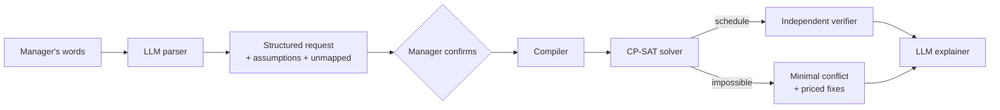

# AI Shift Scheduler

**A manager describes the week in plain English and gets a staff schedule that cannot break a labour rule, or a proof that none exists and what it would cost to fix.**

> Built summer 2026 · Source private

*Real run, with the 20-second wait cut. Every certified closer is off on Friday, so no legal schedule exists. It names the rules that clash and prices each fix by actually re-solving. Lowering the safety rule is flagged risky and still doesn't work.*

## Purpose

**Hypothesis:** an LLM on its own will return a schedule that reads well and quietly breaks a labour law. Give language to the LLM and the rules to a solver, and the result beats an LLM-only baseline on rule violations.

In scheduling, a plausible wrong answer is worse than no answer. A café manager talks the way people talk: "Ana can't do Monday, keep it cheap, nobody closes then opens." That's the half an LLM is good at. Turning it into a schedule that provably respects every rule is the half it isn't.

## What it does

1. **The manager** writes the week as they'd say it out loud.
2. **The LLM** turns that into a structured request and lists what it assumed and what it couldn't express.
3. **The manager** can read that back in plain English and correct it before anything is solved.
4. **The solver** returns the cheapest schedule that meets every rule, or proves that no schedule can.
5. **If it's impossible**, the system names the smallest set of rules that clash and prices each way out.

What step 2 looks like, from a real run:

| Said | Decided | Because |
|---|---|---|
| "Ana can't do Monday at all" | Hard rule: Ana unavailable Monday | A stated fact, not a preference |
| "Ben would rather do opens" | Soft preference | Softly worded, so soft by policy |
| "Keep it cheap" | No budget cap; cost weighted higher | No dollar figure was given, so it won't invent one |
| "Everyone redo the food-safety quiz" | Not mapped | The schema can't express training prerequisites, so it says so instead of dropping it |

## Architecture

The approach, in five decisions:

- **The LLM never writes solver code.** It fills a closed schema of 14 rule types, and validation is the trust boundary. Nothing downstream rereads the raw text.
- **The solver decides.** CP-SAT returns either the proven cheapest schedule or a proof that none exists. "Looks right" is not an answer.
- **A second, separate implementation checks every schedule.** The verifier never imports the compiler and recomputes every number from scratch. In one test, putting one person on a shift they'd ruled out triggered four separate detections. Any schedule it rejects is never shown.
- **Impossible weeks get evidence, not an apology.** The system finds the smallest set of rules that conflict, then prices each way out by actually re-solving. Legal rules are never offered as something to relax.
- **The explainer only sees evidence.** It narrates the result and the priced options. It can't invent a rule or change a price.

| Part | Choice |
|---|---|
| Language | Claude (parser and explainer) |
| Optimisation | Google OR-Tools CP-SAT |
| Code | Python, Pydantic, 312 automated tests |
| Benchmark | 100 generated weeks with exact answers (20 impossible, 15 off-menu, 15 ambiguous) plus 10 hand-written ones |

## Outcome

The benchmark harness is built and tested. The full run hasn't happened yet, so no result is claimed.

| Metric | What it tests | Result |
|---|---|---|
| Rule violations, pipeline vs LLM-only | The core hypothesis | Pending |
| Impossible weeks correctly refused (of 20) | Does it say "can't" instead of inventing a schedule? | Pending |
| Cost vs the true cheapest schedule | Is the schedule good as well as legal? | Pending |

## What I learned

- **Live runs find what tests can't.** Hundreds of green tests passed, and the first real run still scheduled a minor for 9.5-hour days, seven days straight. The demo had dropped the café's 44 standing house and legal rules. Stubs only test your own assumptions. With the rules enforced, the week costs $388 more; the cheaper schedule was cheap only because it was illegal.
- **Make the comparison fair before you publish it.** To head off "you handicapped the baseline", I gave it maximum reasoning effort. Measured, both maximum and medium effort used their whole 64,000-token budget thinking and returned nothing; high effort finished. Left alone, the baseline would have scored zero for budget reasons, not ability.
- **Check that the test data measures what you think it does.** One spot check, parsing a single generated scenario, showed that the test generator had been handed "prefer_shift_type constraint" instead of "Yuki prefers mid shifts". Every preference result would have measured the generator and called it a parser error.

---

More about me at [shrikantvarma.com](https://shrikantvarma.com).
